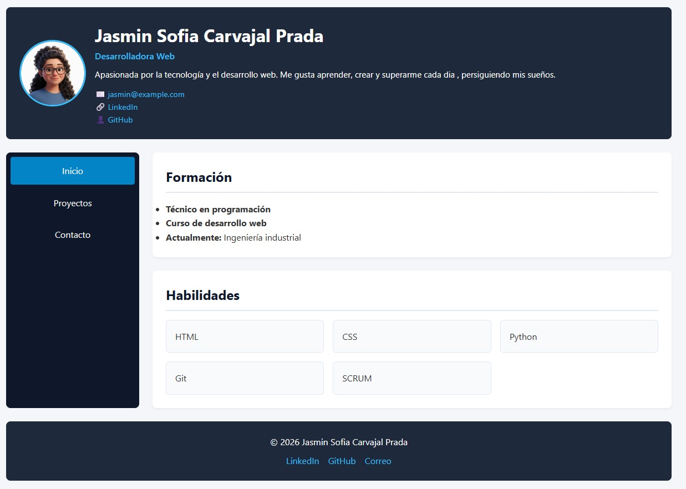
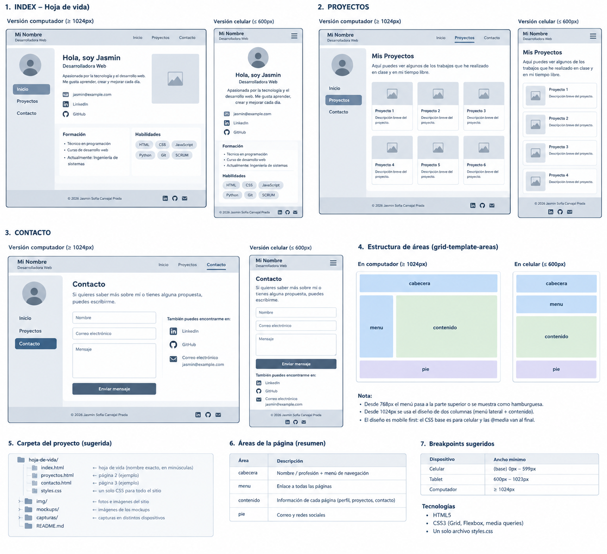
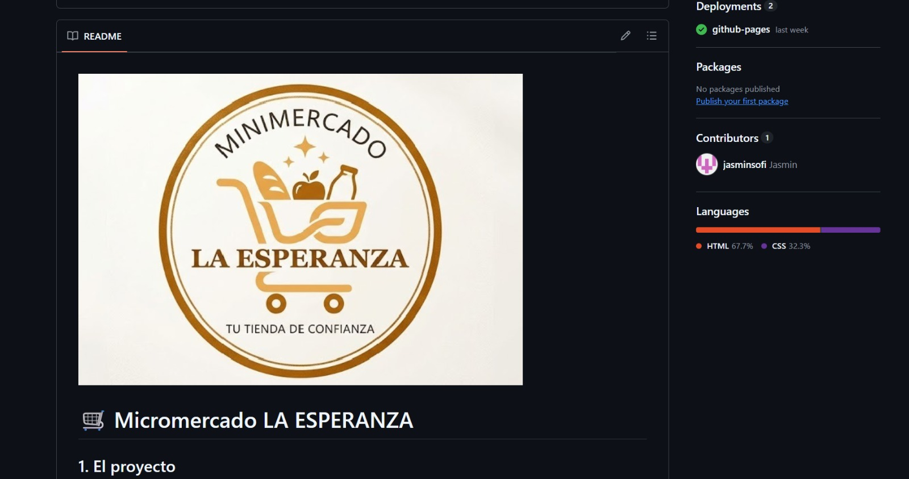
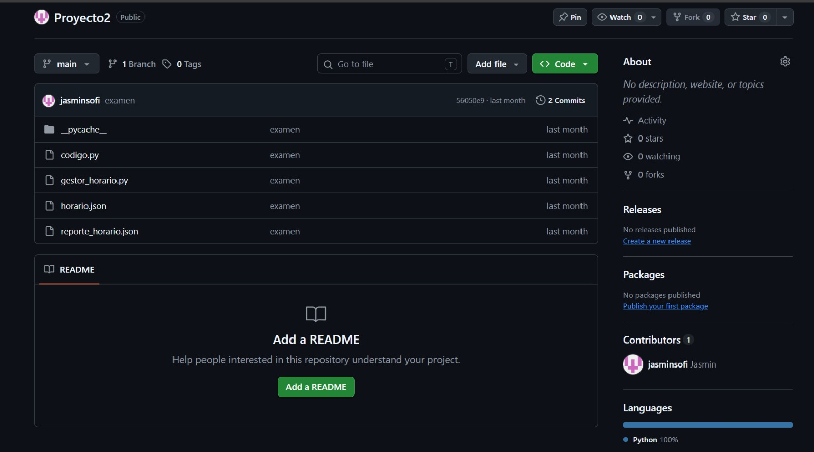
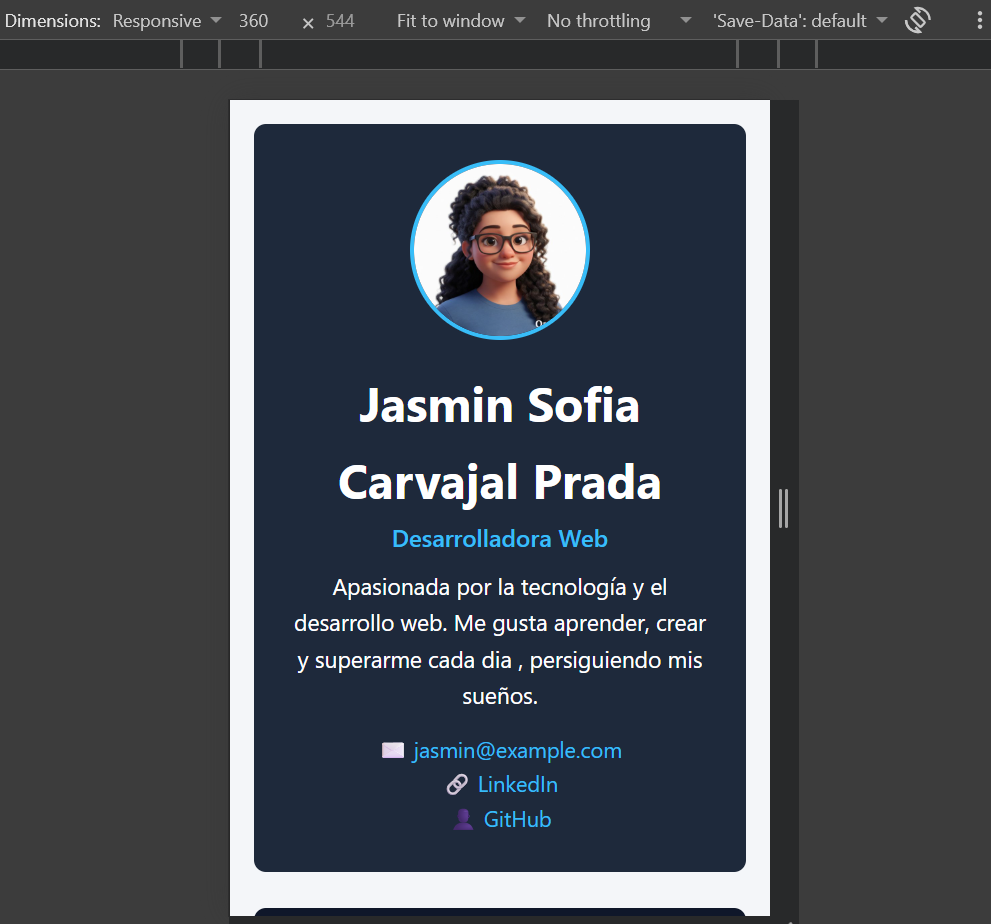
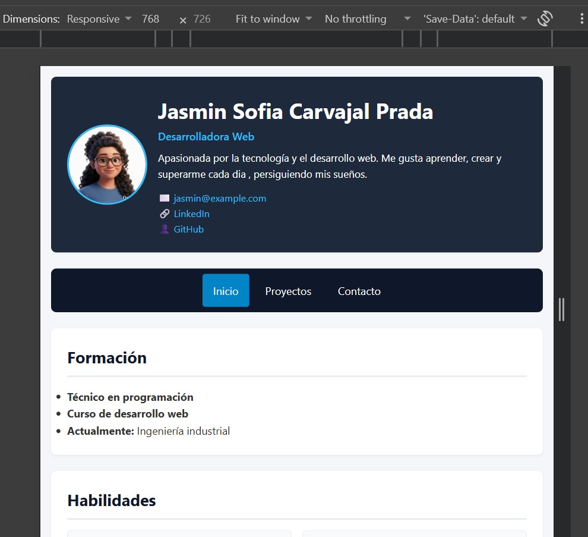

# 👤 Hoja de Vida Web - Jasmin Sofia Carvajal Prada

Sitio web personal y profesional adaptable (responsive), creado con HTML y CSS, e implementado en internet mediante GitHub Pages. Incluye mi hoja de vida, mis proyectos destacados y una sección de contacto e intereses personales.

**Sitio publicado:** https://jasminscarvajal.github.io/hoja-de-vida/

## 💻 Páginas del Sitio

  

  

* `index.html`: Página principal con mi hoja de vida (perfil, formación y habilidades).
* `proyectos.html`: Catálogo de los proyectos de desarrollo realizados.
* `contacto.html`: Formulario de contacto y sección sobre mis intereses (películas, hobbies y ciudad).

## ✏️ Mockups (Diseño previo)

### Hoja de vida, Proyectos y Contacto

  

## 📸 Capturas del sitio publicado

## Proyectos y Trabajos

### Proyecto 1 

  

 

### Proyecto 2

  

## 🌐 Breakpoints utilizados

* **Base (Celular - < 600px):** 

  

Todo el contenido se organiza en una sola columna vertical utilizando `grid-template-areas` con las áreas apiladas (cabecera, menú, contenido y pie).

* **Desde 768px (Tablet):** 

  

El menú de navegación pasa de una lista vertical a una barra horizontal centrada, y los elementos de la cabecera se alinean horizontalmente.

* **Desde (Computador):** 

 

  

Se reestructura el diseño por completo mediante `grid-template-areas`, fijando el menú de navegación en una columna lateral a la izquierda (`240px`) y el contenido principal a la derecha (`1fr`).

## 🖥️ Cómo lo publiqué
1. Creé un repositorio público llamado `hoja-de-vida` en mi cuenta de GitHub.
2. Subí todos los archivos del proyecto organizados correctamente (`index.html`, `proyectos.html`, `contacto.html`, la hoja de estilos en `css/styles.css`, y las carpetas `img/`, `mockups/` y `capturas/`).
3. Fui a la pestaña **Settings** (Configuración) de mi repositorio en GitHub y seleccioné la sección **Pages** en el menú lateral.
4. En la sección de despliegue (**Build and deployment**), elegí la rama `main` y la carpeta `/ (root)`, luego hice clic en **Save**.
5. Esperé un par de minutos a que GitHub procesara el despliegue y obtuve el enlace público definitivo de mi página web.

## 🔗Fuentes consultadas
* Documentación oficial de GitHub Pages: [https://docs.github.com/es/pages](https://docs.github.com/es/pages)
* Guías de CSS Grid y Responsive Design en MDN Web Docs: [https://developer.mozilla.org/es/docs/Web/CSS/CSS_Grid_Layout](https://developer.mozilla.org/es/docs/Web/CSS/CSS_Grid_Layout)
* Validador HTML del W3C: [https://validator.w3.org/](https://validator.w3.org/)